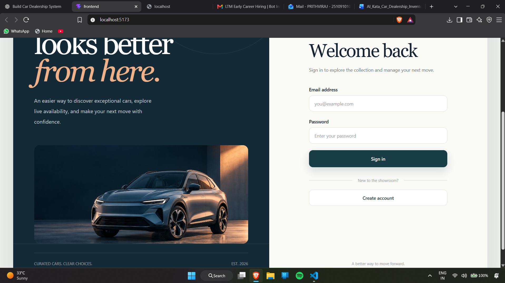
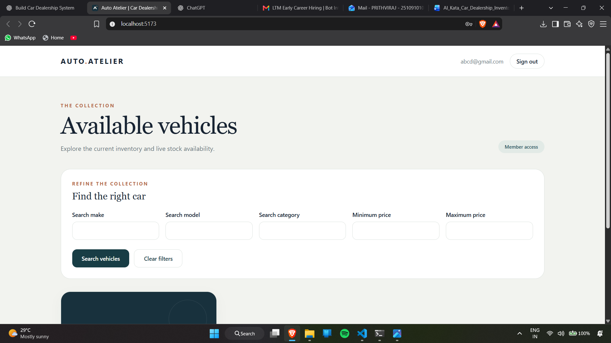
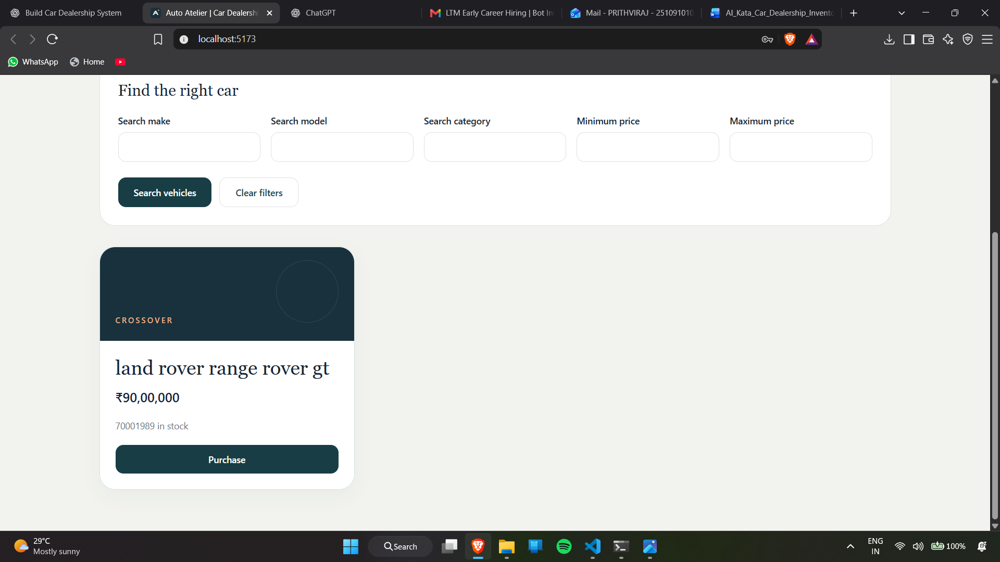
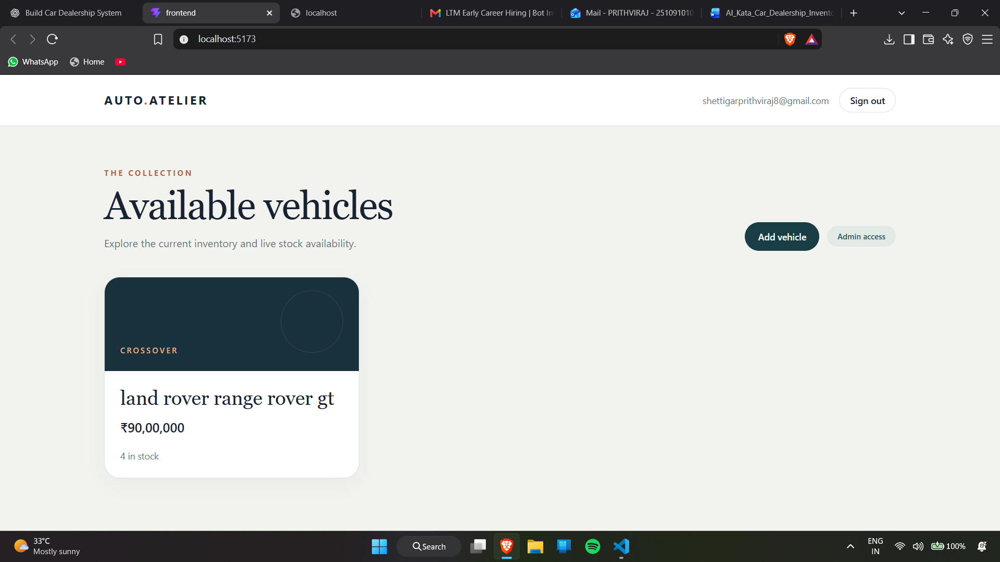
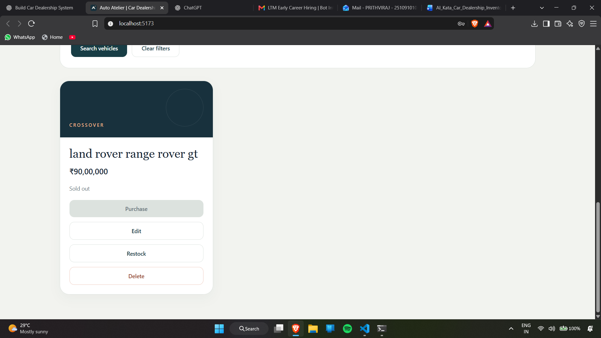

# Auto Atelier — Car Dealership Inventory

A responsive vehicle showroom and inventory manager built for the Incubyte TDD kata. Customers can register, browse, filter, and purchase vehicles. Administrators can also create, edit, delete, and restock listings. Inventory is stored in SQLite, and the API uses bearer tokens and role checks.

## Features

- Customer registration and login with Argon2 password hashing and expiring JWTs.
- Role-protected REST API; public registration always creates a customer account.
- Search by make, model, category, and inclusive minimum or maximum price.
- Atomic stock decrement so concurrent requests cannot both buy the last car.
- Admin-only vehicle creation, editing, deletion, and restocking.
- React, TypeScript, and Tailwind UI with responsive layouts, empty states, validation feedback, and sold-out controls.

## Stack and structure

| Area | Technology |
| --- | --- |
| API | Python, FastAPI, Pydantic, SQLAlchemy |
| Data | File-backed SQLite |
| Auth | Argon2 via pwdlib, PyJWT |
| UI | React, TypeScript, Vite, Tailwind CSS |
| Tests | pytest, pytest-cov, Vitest, Testing Library |
| Deployment | Multi-stage Docker image; Render web service with persistent disk |

`backend/app` holds API routes, models, security, and database configuration. `frontend/src` holds the UI and API client. The Vite development server proxies `/api` to FastAPI; the production image serves the built UI and API from one origin.

## Run locally on Windows (PowerShell)

Requirements: Python 3.13, Node.js 24, npm, and Git. Run these commands from the repository root. If your versions differ, install the dependencies and verify the tests before assuming compatibility.

### 1. Backend

```powershell
Set-Location backend
python -m venv .venv
.\.venv\Scripts\python.exe -m pip install -r requirements.txt
Copy-Item .env.example .env
.\.venv\Scripts\python.exe -c "import secrets; print(secrets.token_urlsafe(48))"
```

Put the generated value after `JWT_SECRET=` in `backend/.env`. Do not commit that file or share the value. Then start the API:

```powershell
.\.venv\Scripts\python.exe -m uvicorn app.main:app --reload
```

API health check: <http://127.0.0.1:8000/health>. Interactive documentation: <http://127.0.0.1:8000/docs>. The local database is created automatically at `backend/inventory.db`.

### 2. Frontend

In a **second** PowerShell terminal from the repository root:

```powershell
Set-Location frontend
npm ci
npm run dev
```

Open <http://localhost:5173/>. The development proxy sends `/api` requests to `127.0.0.1:8000`, so the backend must be running.

### 3. Create a local admin

Registering in the UI creates a customer account. To create an administrator, run this command in another terminal from `backend`:

```powershell
.\.venv\Scripts\python.exe -m app.admin
```

Enter an unused email address and a password of at least 12 characters. Password entry is hidden. You can then sign in with that account in the UI. The admin command will not promote an existing customer.

## API

Except for registration, login, and health, these routes require `Authorization: Bearer <token>`.

| Method | Route | Access | Purpose |
| --- | --- | --- | --- |
| POST | `/api/auth/register` | Public | Create customer |
| POST | `/api/auth/login` | Public | Receive JWT |
| GET | `/api/auth/me` | Signed in | Current account and role |
| GET | `/api/vehicles` | Signed in | List inventory |
| GET | `/api/vehicles/search` | Signed in | Filter inventory |
| POST | `/api/vehicles` | Admin | Add vehicle |
| PUT | `/api/vehicles/{id}` | Admin | Replace vehicle details |
| DELETE | `/api/vehicles/{id}` | Admin | Remove vehicle |
| POST | `/api/vehicles/{id}/purchase` | Signed in | Decrement stock |
| POST | `/api/vehicles/{id}/restock` | Admin | Increment stock |
| GET | `/health` | Public | Health check |

Vehicle JSON uses `make`, `model`, `category`, `price`, and `quantity`. Search accepts `make`, `model`, `category`, `min_price`, and `max_price` query parameters. Price is represented as a decimal by the backend and returned as a string in JSON.

## Tests and TDD

From `backend`:

```powershell
.\.venv\Scripts\python.exe -m pytest -q --cov=app --cov-report=term-missing
```

From `frontend`:

```powershell
npm test
npm run build
npm run lint
```

See [TEST_REPORT.md](TEST_REPORT.md) for the verified results of this supplied snapshot. Backend tests use a temporary **file-backed** SQLite database. The test suite covers authorization, invalid input, inventory lifecycle, and two concurrent attempts to buy the last vehicle. Frontend tests cover registration, login, search, purchase, sold-out behavior, admin actions, and failure recovery. The commit history in your original Git repository records the Red–Green steps; copy these updated files into that repository without replacing its `.git` folder.

## Deploy to Render

This project uses **one paid Render web service with a persistent disk**. Render's free web service has an ephemeral filesystem; using it with SQLite would lose accounts and inventory on a restart or redeploy. Check the current Render pricing before creating a paid service. The frontend and API run on the same origin, so no CORS configuration or frontend API URL is needed.

1. Push the repository to GitHub. Keep `.env`, `inventory.db`, `.venv`, and `node_modules` out of Git. Confirm the required submission documents and screenshots are present before sharing the repository.
2. In Render, choose **New → Web Service**, connect the repository, select the **Docker** runtime and a paid compute plan, and leave the root directory at the repository root. The root `Dockerfile` builds the frontend and starts FastAPI on Render's `PORT`.
3. In the service's disk settings, attach a persistent disk with mount path `/var/data`. Select an appropriate size for this small assessment project.
4. Set environment variables `DATABASE_PATH=/var/data/inventory.db` and `JWT_SECRET=<a freshly generated long random value>`. Generate the secret locally with `python -c "import secrets; print(secrets.token_urlsafe(48))"`; paste only the value into Render's environment settings. Never put it in Git.
5. Set the health check path to `/health` and deploy. Check `https://<your-service>.onrender.com/health`, then open the service's root URL to view the frontend.
6. Open the **Shell on the running paid web service** and run `cd /app/backend && python -m app.admin`. Use an unused email and a strong password. The shell must be attached to the live service with its persistent disk; a build command, pre-deploy command, or separate one-off job does not have access to that disk.
7. Verify admin login, vehicle creation, customer registration, search, purchase, and stock after a redeploy. Record the live URL in this README once it works.

Local accounts and inventory are not automatically copied to the deployed database. Create a fresh admin on the deployed service.

**Live application:** add your verified Render URL here before submitting.

## Screenshots

### Welcome and sign in



### Customer inventory



### Purchase and stock update



### Admin inventory



### Stock management



## My AI Usage

I used **ChatGPT** during planning, implementation, debugging, tests, and documentation. It helped draft FastAPI models and routes, SQLAlchemy queries, JWT and role checks, React components, interaction tests, and a deployment approach. It also helped review test failures and create the showroom image. I ran tests in failing and passing states during development, inspected the resulting behavior, and adapted the code to the project requirements.

AI sped up boilerplate and helped me reason through unfamiliar integration details. The most useful checks were the test failures, the concurrent purchase case, and exercising the UI against the actual API. I remain responsible for reviewing the generated code, testing its behavior, and explaining its limitations. Commits containing AI-assisted changes include the required ChatGPT co-author trailer. Add any other AI tools you actually used before submission.

The assessment also requires **raw, unedited prompts or public chat links** in root [PROMPTS.md](PROMPTS.md). Replace its outstanding checklist with your actual exported conversation text or share links. Do not submit a summary in place of the raw record.

## Limitations

- SQLite with a single persistent disk suits this assessment's small deployment; larger multi-instance deployments would need a shared database and migrations.
- A paid Render service and disk may incur charges. Set a budget or remove the service when the assessment ends.
- The app represents a purchase as an inventory decrement; it does not integrate payments or order history.

